  

  
  
  
  

## About

Hi, I'm Miguel, an Informatics Engineering undergraduate at Institut Teknologi Bandung (ITB).

Most of the repositories here began as coursework in algorithm strategy, linear algebra, and software engineering. Where an assignment offered bonus features, such as a GUI, multithreading, or a live deployment, I usually built them in.

Several projects apply algorithms to music. Syncopate improvises jazz with graph search, the timbre synthesizer models an instrument's sound with SVD, and BandWith is a rhythm game that runs in the browser.

## Tech stack

<table>
  <tr>
    <td><b>Languages</b></td>
    <td></td>
  </tr>
  <tr>
    <td><b>Web&nbsp;&amp;&nbsp;backend</b></td>
    <td></td>
  </tr>
  <tr>
    <td><b>Tools</b></td>
    <td></td>
  </tr>
  <tr>
    <td><b>Also&nbsp;used</b></td>
    <td><code>Prolog</code> <code>SFML</code> <code>CustomTkinter</code> <code>Web Audio API</code> <code>Chrome Extensions (MV3)</code></td>
  </tr>
</table>

## Featured projects

<table>
  <tr>
    <td width="50%" valign="top">
      <h3><a href="https://github.com/miguelsinaga/jazz-improv-generator-with-BFS-DFS">Syncopate</a></h3>
      
Generates jazz improvisation over a chord progression by running BFS and DFS on a weighted directed graph of notes. The edge weights follow jazz theory, favoring stepwise motion, chord tones, bebop scales, and chromatic enclosures. Everything runs in the browser.

      
<code>JavaScript</code> <code>Web Audio API</code> <code>Java</code> <code>Spring Boot</code> <code>JGraphT</code>

      
<a href="https://jazz-improv-generator-with-bfs-dfs.vercel.app"><b>Live demo →</b></a>

    </td>
    <td width="50%" valign="top">
      <h3><a href="https://github.com/miguelsinaga/Tubes3_MADU303">Judol Detector</a></h3>
      
Chromium extension that highlights online-gambling content on any page and can blur it. The string matching is written from scratch with KMP, Boyer-Moore, Aho-Corasick, Rabin-Karp, and regex, plus a weighted Levenshtein distance that catches disguised spellings.

      
<code>TypeScript</code> <code>Vite</code> <code>Manifest V3</code>

      
Team project

    </td>
  </tr>
  <tr>
    <td width="50%" valign="top">
      <h3><a href="https://github.com/miguelsinaga/Tucil2_13524069_13524137">Voxelizer 3000</a></h3>
      
Turns <code>.obj</code> meshes into voxels with a divide-and-conquer octree and AABB–triangle intersection tests. The octree is built on multiple threads, and a software 3D viewer renders the result without the GPU, using its own camera transform, perspective projection, and painter's algorithm.

      
<code>C++17</code> <code>SFML</code> <code>std::thread</code>

      
Pair project

    </td>
    <td width="50%" valign="top">
      <h3><a href="https://github.com/miguelsinaga/Makalah-Algeo">SVD Timbre Synth</a></h3>
      
Models an instrument's timbre from an audio sample with Singular Value Decomposition, then plays it back on a virtual keyboard. FFT, MFCC, and YIN pitch detection are implemented in JavaScript.

      
<code>React</code> <code>Vite</code> <code>Tailwind CSS</code> <code>Express</code> <code>Web Audio API</code>

    </td>
  </tr>
  <tr>
    <td width="50%" valign="top">
      <h3><a href="https://github.com/miguelsinaga/BandWith">BandWith</a></h3>
      
Four-lane rhythm game for the browser. Hit <kbd>D</kbd> <kbd>F</kbd> <kbd>J</kbd> <kbd>K</kbd> as notes fall onto the receptors; tighter timing builds your score and combo multiplier.

      
<code>React</code> <code>Vite</code> <code>Howler.js</code> <code>Supabase</code>

    </td>
    <td width="50%" valign="top">
      <h3><a href="https://github.com/miguelsinaga/Survival-Kit-Website">Maison Safe</a></h3>
      
Web app for keeping an emergency survival kit ready. It tracks kit status and includes an SOS screen, a survival guide, alerts, and a list of emergency contacts.

      
<code>JavaScript</code> <code>Express</code> <code>PostgreSQL</code> <code>Vercel</code>

      
<a href="https://survival-kit-website.vercel.app"><b>Live demo →</b></a>

    </td>
  </tr>
</table>

**More**

- [FoodShare](https://github.com/miguelsinaga/-IF2150-2025-K02-G11-FoodShare): desktop food-donation app with provider, receiver, and admin dashboards. `Python` `CustomTkinter`
- [Grid Pathfinder](https://github.com/miguelsinaga/Tucil3_13524069): weighted grid puzzle with checkpoints, solved by UCS, Greedy Best-First, and A\*, with a Swing GUI. `Java`
- [Queens Solver](https://github.com/miguelsinaga/TUCIL1_13524069): the Queens puzzle with region constraints, standard library only. `C++`
- Lab work for Algorithms & Programming [1](https://github.com/miguelsinaga/Praktikum-Algoritma-dan-Pemrograman-1-IF-ITB-2024) and [2](https://github.com/miguelsinaga/Praktikum-Algoritma-dan-Pemrograman-2). `C` `Haskell`

## GitHub activity

  

  

  

  
   
  Thanks for stopping by. <a href="https://github.com/miguelsinaga">@miguelsinaga</a>

